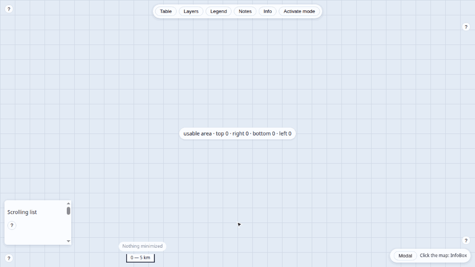

# <picture><source media="(prefers-color-scheme: dark)" srcset=".github/assets/icon-dark.svg"></picture> biombo

[](https://www.npmjs.com/package/biombo)
[](https://bundlejs.com/?q=biombo)
[](LICENSE)

Headless panel and window management for React: z-order, focus, Escape stack, docking, minimize and persistence.



**[Live demo](https://ghegar.github.io/biombo/)**

biombo owns the state — stacking, focus, Escape, docking, minimize, tabs, persistence — and you own every
pixel: it ships no styles, only state, events, `data-*`/ARIA attributes and the functional inline style
(`position`, `left/top/width/height`, `z-index`). Docked panels shrink the usable area it reports, so your
own content (a map, an editor) stays visible next to them.

## Install

```bash
npm install biombo
```

| Entry | What it is | Needs |
|---|---|---|
| `biombo` | Framework-free core: manager, z-order bands, Escape stack, layout, persistence, anchoring | nothing |
| `biombo/react` | `BiomboProvider`, `usePanel` and the layout, tabs and surface hooks; re-exports the core | `react >= 19`; `react-dom >= 19` for `Portal` |

## Quick start

```tsx
import { BiomboProvider, useArea, usePanel } from 'biombo/react';

function Table() {
    const panel = usePanel('table', { dockable: ['bottom'], initial: { open: true } });
    return <section {...panel.getWindowProps()}><header {...panel.getHandleProps()}>Drag me to the bottom edge</header></section>;
}

function Map() {
    const { top, right, bottom, left } = useArea();
    return <main style={{ position: 'fixed', inset: `${top}px ${right}px ${bottom}px ${left}px` }} />;
}

export const App = () => <BiomboProvider><Map /><Table /></BiomboProvider>;
```

## Core

```ts
import { createManager, localStorageAdapter } from 'biombo';

const manager = createManager({
    edges: { right: { policy: 'tabs' } },
    persist: { storage: localStorageAdapter(), key: 'app.panels', version: 1 },
    onEvent: (event) => sync(event),
});

manager.register('layers', { dockable: ['left', 'right'] });
manager.subscribe(() => render(manager.getSnapshot()));
manager.open('layers');
manager.dock('layers', 'right');
manager.setDockSize('layers', 320);
```

`BiomboProvider` creates a manager from `options`, or takes yours through `manager`.

### Stacking and focus

Every panel lives in a named band; biombo orders panels inside each band and the band sets the base
`z-index`. Opening or pressing a panel brings it to the front of its band and marks it `active`.
The default bands and their base: `overlay` 5, `docked` 20, `floating` 30, `menu` 50 and `modal` 60.
Pass `bands` to replace them and `band` per panel to choose one. A group with `mode: 'single'` shows
one panel at a time; `free` (the default) lets them overlap.

### Escape stack

One Escape closes only the topmost layer. Layers are ordered by priority, then by recency:

| Priority | Value | For |
|---|---|---|
| `ESCAPE_PRIORITY.mode` | 0 | Global modes, which close last (`useGlobalMode`) |
| `ESCAPE_PRIORITY.surface` | 100 | Panels (the default `escapePriority`) |
| `ESCAPE_PRIORITY.menu` | 200 | Menus and popovers |
| `ESCAPE_PRIORITY.modal` | 300 | Modals |

The provider listens on `window` in the capture phase and stops the event it handles. Pass
`listenEscape={false}` and call `manager.escape.handle(event)` to route it yourself.

### Docking and the usable area

A panel docks to the edges listed in `dockable`. Each edge has a policy for a second panel:

| Policy | Behavior |
|---|---|
| `replace` | The new panel takes the edge; the previous one floats again (the default) |
| `stack` | Panels share the edge, one after the other |
| `tabs` | One panel shows at a time; `useEdge` and `useTabs` give the strip |

Docked sizes start at 40 % of the viewport, never below 120 px nor above 80 %
(`defaultDockRatio`, `minDockSize`, `maxDockRatio`). The snapshot keeps the usable `area` left by the
docked panels; `useArea` reads it and `onAreaChange` reports it. When the browser resizes, biombo clamps
floating rects and docked sizes again.

### Drag, snap and resize

`getHandleProps` drags with `left/top` written in a `requestAnimationFrame` and saves on release; links,
buttons, form fields and `[data-biombo-nodrag]` inside the handle do not start a drag. With `snap` set
to `auto` or `both` a panel docks when the pointer reaches an edge it can dock to, and through `dock()`;
with `button`, only through `dock()`. `useSnapPreview` gives the rect to draw while dragging.
`undockOnDrag` (`true` or a distance in px) lets a docked panel float again when dragged.
`getResizerProps(direction)` resizes floating panels by side or corner and docked panels along their edge.

### Presentation

`state.presentation` says how to draw the panel: `hidden`, `floating`, `docked`, `maximized`, or the
panel's `compact` mode (`sheet`, `fullscreen`, `inline`) below `compactBreakpoint`. Minimizing only
keeps the state: draw the pill yourself from the panels that are `open` and `minimized`. `contain: 'full'`
keeps a floating panel fully on screen instead of partially, `containMargin` px from the edges.

### Persistence and events

`persist` saves `minimized`, `dock`, `dockSize` and `rect` by default (list `open` in `fields` to
keep it too), under a `key` and a `version`; `migrate` upgrades older data. `serialize` and `hydrate`
let you store the layout elsewhere. `onEvent` reports `open`, `close`, `focus`, `minimize`, `restore`, `maximize`, `unmaximize`,
`dock`, `undock`, `resize`, `move` and `reorder`, each with `id` and `group`.

## React

```tsx
import { BiomboProvider, localStorageAdapter, usePanel } from 'biombo/react';

function Table() {
    const panel = usePanel('table', { dockable: ['bottom'], defaultSize: { width: 520, height: 280 } });
    return (
        <>
            <button onClick={() => panel.toggle()}>Table</button>
            <section {...panel.getWindowProps()} className="your-styles">
                <header {...panel.getHandleProps()}>Drag me</header>
                <div {...panel.getResizerProps()} />
            </section>
        </>
    );
}

const options = { persist: { storage: localStorageAdapter(), key: 'app.panels', version: 1 } };

export const App = () => <BiomboProvider options={options}><Table /></BiomboProvider>;
```

| Hook | For |
|---|---|
| `usePanel` | State, actions and prop getters of one panel: `getWindowProps`, `getHandleProps`, `getResizerProps(direction?)` |
| `useEdge`, `useTabs` | The panels of an edge and its tab strip, with keyboard and drag reorder (`onReorder`), controlled or not |
| `useCompact` | Whether compact mode is on, below `compactBreakpoint` |
| `useClearance`, `useObstacle` | Offset that keeps a floating control clear of panels and registered obstacles |

F6 (`cycleKey`) moves focus between open panels, and closing a panel returns focus to the element that
opened it.

### Surfaces

These hooks work with or without `BiomboProvider`:

| Hook | Does |
|---|---|
| `useFocusTrap` | Focus trap with stacked traps, `inert` for the rest of the page and focus returned on close |
| `useScrollLock` | Body scroll lock that survives nested modals |
| `useDismissOutside` | Dismiss on a press outside, topmost surface only |
| `useAnchoredPosition`, `placeAnchored` | Anchored to an element or a point, flipping and clamped to the viewport; `over` centers on it |
| `useDraggable` | Drag any element inside the viewport, alone or on top of an anchored surface |
| `useDismissGesture` | Swipe to dismiss, driven by CSS variables instead of re-renders |
| `Portal` | Render into `document.body`, SSR-safe |

A modal combines four of them:

```tsx
import { ESCAPE_PRIORITY, Portal, useDismissOutside, useEscape, useFocusTrap, useScrollLock } from 'biombo/react';

function Modal({ onClose, children }) {
    const ref = useRef(null);
    const { getTrapProps } = useFocusTrap(ref);
    const { getDismissProps } = useDismissOutside(ref, onClose);
    useScrollLock();
    useEscape(onClose, { priority: ESCAPE_PRIORITY.modal });
    return (
        <Portal>
            <div ref={ref} {...getTrapProps()} {...getDismissProps()} role="dialog" aria-modal="true">{children}</div>
        </Portal>
    );
}
```

A tooltip anchors to its trigger; an info box anchors to a map click and can be dragged away:

```tsx
const anchored = useAnchoredPosition(tipRef, { anchor: triggerRef, open, placement: 'top' });
<div ref={tipRef} {...anchored.getFloatingProps()} role="tooltip" />

const drag = useDraggable(boxRef, { margin: 10 });
const anchored = useAnchoredPosition(boxRef, { anchor: { x, y }, shift: drag.offset, paused: drag.dragging });
<div ref={boxRef} {...anchored.getFloatingProps()}><header {...drag.getHandleProps()} /></div>
```

`useDismissGesture` writes `--biombo-swipe` (px) and `--biombo-swipe-progress` (0–1) on the element and sets
`data-swipe` to `idle`, `moving`, `armed` or `dismissed`; the animation is yours:

```css
.card { transform: translateX(var(--biombo-swipe, 0px)); opacity: calc(1 - var(--biombo-swipe-progress, 0) * 0.6); }
.card[data-swipe='idle'], .card[data-swipe='dismissed'] { transition: transform 0.22s, opacity 0.22s; }
```

Notes:

- `position: fixed` is relative to the nearest ancestor with `transform`, `filter` or `contain`, not to the
  viewport. Render anchored surfaces through `Portal` (this needs `react-dom`, an optional peer).
- In a registered panel, pass `returnFocus: false` to `useFocusTrap`: closing the panel already returns focus
  to its trigger.
- `useAnchoredPosition` owns the inline `max-height` and `max-width` of the surface.
- A surface rendered through a portal inside another one counts as inside it for `useDismissOutside` when
  the outer surface spreads `getDismissProps()`.

## Known limitations

- Panels move and resize with the pointer only; keyboard move and resize are planned after 1.0.
- In compact mode there is no drag, snap, undock or resizer. The dock is kept and applies again above
  the breakpoint.
- A hidden panel gets `hidden` and `display: none` inline, so your own `display` on it does not apply
  while it is closed.
- Without a provider, `useEscape` uses a global stack. If the provider and layers outside it share a page,
  the listener registered first wins: put `BiomboProvider` at the root.
- There is no fully controlled `state` prop: sync through `serialize`, `hydrate`, `onEvent` and, for tabs,
  `onReorder`.

## Development

```bash
npm test
npm run lint
npm run typecheck
npm run demo
npm run e2e
```

The demo is a playground over a fake map: five panels that float, dock to every edge with `stack` and
`tabs` policies, minimize to a pill bar and report the usable area, plus a modal, tooltips and an info box
anchored to map clicks that can be dragged or swiped away. The e2e suite runs Playwright against it.

## Contributing

Issues are welcome. Open one before sending a pull request.

## License

AGPL-3.0-only © GHEgar
